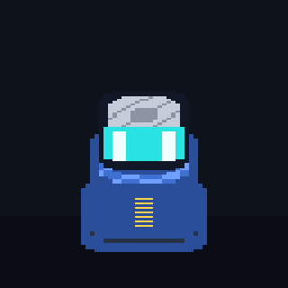

# flutter_sprite_stack

[](https://pub.dev/packages/flutter_sprite_stack)
[](LICENSE)
[](https://flutter.dev)
[](https://docs.page/RafaelBarbosatec/flutter_sprite_stack)

📖 **Documentation:** https://docs.page/RafaelBarbosatec/flutter_sprite_stack

Render **sprite-stacking** props in Flutter with free turntable rotation.

A sprite stack is a set of horizontal cross-sections of a 3D shape. Drawing
them bottom-up — each one rotated and vertically squashed — produces a fake-3D
billboard you can spin in any direction. It is the same trick pixel-art games
have used since the 90s, with a **1x art-pixel software rasterizer** and no 3D
pipeline.



*The example F1 car spinning at runtime — four arbitrary angles of a 15-slice
strip, not 8 pre-baked directions.*

```
slices (ground slice on the left)
┌────┬────┬────┬────┬────┐
│ 0  │ 1  │ 2  │ …  │ 23 │   each slice: top-down cross-section
└────┴────┴────┴────┴────┘
        ↓ render bottom-up
      ╱▔▔╲        yaw     → rotation around the vertical axis
     │    │       pitch   → camera tilt (0 = edge-on, π/2 = top-down)
      ╲__╱        spacing → lift between slices
```

## Features

- **Free rotation**, not 8 or 16 baked directions: any `yaw` at runtime.
- **Cheap**: one texture, a 1x art-pixel software rasterizer, nearest-neighbour filtering.
- **Pixel-art finish**: crisp 1 px ink outline and a projected ground shadow,
  matching the reference `viewer.html` look.
- **Tiny API**: load a strip, call `render`.
- **Flutter and any canvas-based engine**: `CustomPainter` for plain canvases;
  in Flame, Bonfire or a custom loop, call `render` from your own component.
- **No 3D engine, no shaders, no platform channels** — it is just `Canvas`.

## Installation

```bash
flutter pub add flutter_sprite_stack
```

Or add it manually:

```yaml
dependencies:
  flutter_sprite_stack: ^0.4.0
```

Requires Flutter 3.22+ and Dart 3.5+. Works on every platform Flutter supports,
including web.

## Quick start

```dart
import 'package:flutter_sprite_stack/flutter_sprite_stack.dart';

final robot = await SpriteStack.load(
  'assets/robot_stack.png',
  sliceCount: 24, // must divide the image width exactly
);

// Any Canvas: bottom-centre is the ground contact point.
robot.render(
  canvas,
  position: const Offset(160, 240),
  yaw: 0.6,                        // radians
  pitch: SpriteStack.defaultPitch, // asin(0.75), the reference 0.75 squash
  scale: 6,                        // integer scale keeps pixels crisp
  spacing: 1,                      // lift per slice, in source pixels
  roll: 0,                         // screen-space tilt (bank/lean), radians
  rollPivot: 0,                    // 0 = feet planted, 0.5 = body middle
  outline: true,                   // crisp 1 px ink outline around the stack
  shadow: true,                    // projected ground shadow
);
```

`yaw` and `pitch` pick the viewpoint; `roll` tilts the finished sprite in screen
space, like the pitch squash: a drawing effect, not a re-projection. It rotates
the silhouette without revealing a new side of the prop — for that, turn `yaw`.
Pivot it at the feet (`0`, a grounded lean) or at the body middle (`0.5`, a
banked aircraft). `boundsFor` accounts for it, so culling stays correct.

### Plain Flutter

```dart
CustomPaint(
  size: const Size(320, 320),
  painter: SpriteStackPainter(
    stack: robot,
    yaw: 0.6,
    scale: 6,
  ),
)
```

`SpriteStackPainter` anchors the stack at the bottom centre of the canvas and
re-paints when `yaw`, `pitch`, `scale`, `spacing`, `offset`, `outline`,
`shadow`, their colors or `stackPaint` change.

### Game engines (Flame, Bonfire, custom loop)

The package deliberately ships no engine component: it only needs a `Canvas`,
so it stays free of engine version constraints. In Flame or Bonfire, wrap it in
any component that exposes `render(Canvas)` and size it from the projected
bounds:

```dart
class StackProp extends PositionComponent {
  StackProp({required this.stack, required Vector2 ground, this.yaw = 0})
      : super(position: ground, size: Vector2.zero()) {
    final bounds = stack.boundsFor(yaw: yaw, scale: 4);
    size = Vector2(bounds.size.width, bounds.size.height);
  }

  final SpriteStack stack;
  final double yaw;

  @override
  void render(Canvas canvas) {
    stack.render(
      canvas,
      position: Offset(size.x / 2, size.y), // ground point
      yaw: yaw,
      scale: 4,
    );
  }
}
```

`boundsFor` gives the **projected** bounds — rotated footprint, outline and
shadow — so hit boxes, camera culling and Y sorting match what is drawn. `yaw`
spins the prop; it does **not** touch the component's own `angle`, and the
drawing stays anchored by its feet while the bounds change.

## Orbit scene (3D camera)

`SpriteStackScene` places stacks in a world with an orbiting camera — no engine
required. It projects each prop's ground point with perspective and draws far
to near. By default props stay **world-aligned**: the scene derives each prop's
visible yaw and pitch from the camera-to-prop vector, so every prop follows the
projected ground grid and reads as a fixed object on the map while the camera
moves (orbit **or** follow). Set `billboard: true` for a true billboard that
keeps a fixed screen-space facing instead.

```dart
final scene = SpriteStackScene(
  camera: SpriteStackCamera.orbit(yaw: 0.8, pitch: 0.6, distance: 900),
  zoom: 2.4,                       // art pixels per world unit at the target
  sky: const SpriteStackSky(
    top: Color(0xFF070D16),
    horizon: Color(0xFF27435E),
    bottom: Color(0xFF16232F),     // matches the ground's fadeColor
  ),
  ground: const SpriteStackGround(
    extent: 700,
    step: 70,
    cellSize: 70,
    checker: [Color(0xFF142430), Color(0xFF1D303D)],
    fadeColor: Color(0xFF16232F),
    fadeDistance: 2400,
  ),
  objects: [
    SpriteStackSceneObject(
      stack: house,
      position: const SpriteStackPoint(-230, -40, 0), // x, y, z (z is up)
      yaw: 0.5,
    ),
  ],
);
```

From a `Ticker` + `CustomPainter`, once per frame:

```dart
scene.camera.yaw += dt * 0.2;
scene.paint(canvas, size);
```

World units are art pixels, so a 48 px wide house is 48 units wide. `zoom` is
the scale at the camera's target plane; objects closer to the camera grow.

| Piece | Meaning |
| --- | --- |
| `SpriteStackCamera.orbit(yaw:, pitch:, distance:, target:)` | Camera on a sphere around `target`; `pitch` is clamped just short of top-down |
| `SpriteStackScene(camera:, zoom:, background:, sky:, ground:, objects:)` | Projects, depth-sorts and draws the props; `sky` wins over the flat `background` |
| `SpriteStackSceneObject(stack:, position:, yaw:, billboard:, scale:, frame:, cut:, motion:)` | A prop; `position` is its ground point. `yaw` is its world facing by default (`billboard: false`); set `billboard: true` for a fixed screen facing |
| `SpriteStackSky(top:, horizon:, bottom:, horizonFraction:)` | Gradient backdrop anchored to the ground plane's vanishing line |
| `SpriteStackGround(extent:, step:, color:, axisColor:, cellSize:, fill:, checker:, colorAt:, fadeColor:, fadeDistance:)` | Ground plane + grid; painted cells, procedural colors and distance fade |
| `scene.projectObject(object, size)` | Screen ground point, depth, scale, render yaw, render pitch and bounds |
| `SpriteStackFollowCamera(positionRate:, yawRate:, lookAhead:, height:, deadZone:)` | Third-person follow with exponential lag |
| `scene.stats` | `drawn` / `culled` / `behindCamera` / `tooSmall` from the last paint |
| `scene.horizonY(size)` | Screen y of the horizon; can fall outside the canvas |

**Sky and horizon.** `SpriteStackSky` paints a vertical gradient behind
everything, anchored to the horizon — the vanishing line of the ground plane,
the same line `scene.horizonY(size)` reports. It follows the camera pitch, so
orbiting leaves it still and only tilting moves it. Above the horizon it blends
`top` → `horizon`; below it, `bottom` shows wherever the ground does not reach.
Set the ground's `fadeColor` to `bottom` so distant cells dissolve into the
backdrop instead of ending on a hard edge. `horizonFraction` pins the horizon to
a fraction of the canvas instead of deriving it from the camera.

With this projection the horizon only enters the frame at a shallow pitch: a
top-down-ish orbit fills the screen with ground, and there is no sky to see.

**Painting the ground.** The floor is drawn as projected cells clipped against
the near plane: `fill` paints a solid base, `checker` alternates colors by
`(ix + iy)`, and `colorAt(x, y)` returns a color per cell centre for procedural
floors (roads, grass, water, noise) — it is only called for cells that survive
the near-plane and off-canvas reject. `fadeColor` + `fadeDistance` blend distant
cells into the horizon, and `step: 0` hides the grid lines. Cells are flat
colors, not textures — a texture would need subdivision or a textured
rasterizer to be perspective-correct.

Sorting is per object (painter's algorithm), so two intersecting props cannot
resolve per pixel. The volume/mesh is not drawn; pair the scene with
`toVolume()` / `SpriteStackMesher` when you need collision or exact bounds.

**Following a moving prop.** `SpriteStackFollowCamera` aims at a point
`lookAhead` units in front of a subject and swings the camera yaw towards the
subject's facing, both with exponential, frame-rate independent smoothing
(`1 - exp(-rate * dt)`; a rate of `3` is roughly a 330 ms time constant).

```dart
final follow = SpriteStackFollowCamera(lookAhead: 60, yawRate: 3);

// per frame
follow.update(scene.camera, subject: car.position, yaw: car.yaw,
    velocity: velocity, dt: dt);
```

The lag is the point. The subject is world-aligned (the default), so the scene
derives its sprite yaw from the camera-to-prop vector: a camera that copied the
car's yaw instantly would keep that difference at zero and the car would never
appear to rotate — the world would just spin around a locked sprite. Trailing
the subject by a fraction of a second exposes the turn. `distance` and `pitch`
stay in the caller's hands.

**Culling.** Props behind the near plane, props whose projected bounds miss the
canvas and props smaller than `minimumProjectedPixels` (default `0.5`) never
reach `SpriteStack.render`. `scene.stats` reports what happened —
`drawn`, `culled`, `behindCamera`, `tooSmall` — which is the number to watch
when a scene gets heavy. There is no occlusion culling: a prop hidden behind
another is still drawn.

## Animation

Animation is a **frame atlas**: the same horizontal strips stacked vertically,
frame `0` on top. Nothing else changes — the slice format, bounds and outline
are per row.

```
frame 0  [z0][z1][z2] … [zN]   ← sliceCount per row
frame 1  [z0][z1][z2] … [zN]
…
frame 7  [z0][z1][z2] … [zN]
```

```dart
final torch = await SpriteStackAnimation.load(
  'sprites/torch.png',
  sliceCount: 32,
  frameCount: 8,
  frameDuration: 0.13,
  loop: true,
);

// In your update loop:
torch.update(dt);

// In your draw call:
stack.render(canvas, position: ground, frame: torch.frame);
```

`SpriteStackAnimation` handles timing, looping, ping-pong, `play`/`stop`/`reset`
and `onComplete`. The rendering cost does not change: an 8-frame torch still
draws `sliceCount` slices per frame. Drive `dt` through your own multiplier to
sync playback with movement or RPM.

Animate transforms too when it fits better: a spinning coin, a bobbing item or a
pulsing warning light does not need frames at all.

## Motion (sway and lean)

`StackMotion` offsets each slice with a quadratic falloff from the ground, so the
base stays planted and the tip moves. It needs no extra frames — one strip is
enough for a tree, banner, kelp, grass or cape.

```dart
final motion = StackMotion(
  sway: 2.5,    // amplitude at the tip, in source pixels
  speed: 1.8,   // radians per second
  wave: 0.7,    // phase lag per slice: the motion travels up as a wave
  phase: 0,     // desync props that share the same strip
  lean: Offset.zero, // constant bend, e.g. prevailing wind (+y is down)
);

// Any Canvas:
robot.render(canvas, position: ground, motion: motion, time: elapsed);
```

Advance `time` yourself in your game loop; the package does not own a clock.

The sway is `sin(time * speed - slice * wave + phase) * sway * (slice / (n-1))²`.
The squared falloff is what pins slice `0` — it is the formula recommended by
`danielwh2/sprite-stacking`, and it is why the base does not slide.

The software rasterizer works at 1x art-pixel resolution, so motion shifts
slices in whole art pixels. That is the native grid of pixel art; for sub-pixel
smoothness at high display scales, animate the component position instead.

## Cutaways (roof off)

`SliceCut` hides slices above (or below) a continuous frontier. Hide a house's
roof and what remains are the wall cross-sections — a dollhouse view with the
player inside.

```dart
final roof = SliceCut(top: 19);       // slices 0..18, roof gone

// Animate it: `top` is continuous, so the roof disappears slice by slice.
final roof = SliceCut(top: sliceCount * (1 - progress));

house.render(canvas, position: ground, cut: roof);
```

In a game loop, feed the cut to the draw call and recompute the bounds so
culling and hit boxes shrink with the roof:

```dart
final cut = SliceCut(top: 19);
house.render(canvas, position: ground, cut: cut);
final bounds = house.boundsFor(yaw: yaw, scale: 4, cut: cut);
```

The slice sitting at the cut is dissolved with a 4×4 Bayer dither, so the pixel
grid stays intact instead of blending the whole prop. Bounds follow the cut.

## Baking and spinning

The software rasterizer is CPU-bound: it rebuilds a 1x art-pixel buffer on
every call. For scenery that does not change every frame, bake it once and
replay a `Picture`:

```dart
final baked = robot.bake(scale: 4, yaw: 0.6);
baked.draw(canvas, groundPosition); // one drawPicture
// ...
baked.dispose();
```

A prop that spins should use `SpriteStackTurntable`: it bakes one frame per yaw
bucket, lazily, and quantises the angle for you. Pixel art hides the stepping,
so 48–72 buckets read as continuous rotation:

```dart
final turntable = SpriteStackTurntable(tree, buckets: 72, scale: 4);
turntable.warmUp(); // pay the cost up front

// Per frame:
turntable.draw(canvas, groundPosition, yaw);
```

Loading the same asset once per prop is wasted work too — `SpriteStackCache`
shares the decoded strip (image, RGBA read-back and footprint mask):

```dart
final stacks = SpriteStackCache();
final tree = await stacks.load('sprites/tree.png', sliceCount: 43);
final house = await stacks.load('sprites/house.png', sliceCount: 29);
```

## Projected bounds

`size` used to ignore yaw, so a 45° prop drew ~40% wider than its hit box.
`boundsFor` returns the real projected `size` plus the `ground` point, which is
what the component uses for culling and hit testing:

```dart
final bounds = stack.boundsFor(yaw: yaw, scale: 4);
final rect = bounds.rectAt(groundPosition); // ready for Rect.contains
```

## Volume and mesh (3D groundwork)

A strip is a stack of cross-sections, so it also describes the prop's **volume**.
`toVolume()` rebuilds it as an occupancy grid, and `SpriteStackMesher` turns that
grid into the smallest set of axis-aligned quads (greedy meshing). A scene can
use the result to size, cull, collide and depth-sort a prop.

```dart
final volume = stack.toVolume();               // x = column, y = depth, z = slice
final mesh = const SpriteStackMesher().build(volume);

volume.solidVoxelCount;                        // 14 716 for the example car
volume.bounds;                                 // tight box, transparent padding trimmed
mesh.quadCount;                                // 830
mesh.triangleCount;                            // 1 660
```

Faces carry **no colour and no UV**: the mesh is geometry only, because the
sprite stack keeps the drawing job. Coplanar exposed faces are merged, and faces
between two solid voxels are skipped.

| Asset | Grid (x × y × z) | Solid voxels | Quads | Triangles |
| --- | --- | --- | --- | --- |
| `car` | 38 × 72 × 15 | 14 716 | 830 | 1 660 |
| `house` | 48 × 48 × 29 | 18 091 | 1 724 | 3 448 |
| `tree` | 33 × 33 × 43 | 19 903 | 1 435 | 2 870 |

`alphaThreshold` (default `128`) decides what counts as solid, so anti-aliased
slices do not grow a skin of semi-transparent voxels. Volumes are built per
frame, and only stacks loaded with `load`/`decode` keep the raw pixels —
`fromImage` throws a `StateError`.

The scene renderer that consumes this geometry is the next milestone; today the
API ships the volume and the mesher.

## Asset format

- One **horizontal strip** PNG, every slice the same size.
- **Ground slice first** (left), top slice last (right).
- `sliceCount` is required at load time: the PNG carries no metadata.
  `sliceWidth = imageWidth / sliceCount`, `sliceHeight = imageHeight`.
- Transparent background, hard edges, no anti-aliasing.
- The front of the prop points **+Y (down)** in the source images; when driving
  it from a velocity, `yaw = atan2(vy, vx) - pi / 2`.

The strip can come from any voxel editor (MagicaVoxel layer export works) or
from four orthographic views.

## Creating assets

### Four-view pipeline (recommended)

The authoring workflow and the carving tool come from
**[danielwh2/sprite-stacking](https://github.com/danielwh2/sprite-stacking)**
(MIT) — this package exists because that project proved how well the technique
reads in motion, and it implements the same math and the same strip format.

Draw or generate four orthographic views — **TOP, SIDE, FRONT, BACK** — on a
flat background, all at the same scale, then carve them into slices:

```bash
pip install pillow numpy

python3 skills/sprite-stacking/scripts/views_to_slices.py views.png slices.png \
  --slices 24 \
  --shade 0.2 \
  --preview check.png
```

Useful flags:

| Flag | What it does |
| --- | --- |
| `--slices N` | Slice count. 15–20 chunky, 26–44 detailed, 36–56 showcase |
| `--round` | Clips each slice to the ellipse its side/front spans describe (towers, pots, balloons) |
| `--side-nose left\|right` | Which way the SIDE view faces |
| `--order auto\|reading` | Detect the four views by proportions, or trust reading order |
| `--shade 0..1` | Bakes side shading into the slices |
| `--colours N` | One shared palette across the four views |
| `--preview check.png` | Writes a contact sheet so you can inspect the result |

The same folder ships `viewer.html`, a standalone turntable/exploded/slice-scan
viewer that opens any strip you drop on it — handy for checking an asset before
wiring it into the game.

### For AI agents (skill / MCP)

The upstream repository ships an **agent skill** that teaches an assistant the
whole authoring loop: pick a tier, produce or draw a valid four-view sheet,
carve it, inspect the result, then integrate the strip. It works with Claude
Code, Codex, Cursor, OpenCode, Gemini CLI and any agent that can read a
`SKILL.md`:

```bash
npx skills add danielwh2/sprite-stacking
```

Manual installation:

| Agent | Folder |
| --- | --- |
| Claude Code | `~/.claude/skills/` |
| Codex, Cursor, OpenCode, Gemini CLI, Pi | `~/.agents/skills/` |

The skill includes `SKILL.md`, `references/engines.md` (Web/Godot/Unity/Phaser
recipes), `scripts/views_to_slices.py` and `scripts/viewer.html`. Agents that
support MCP can expose that workflow as tools by wrapping the script; the
output format is exactly what `SpriteStack.load` consumes.

### Agent skills (AI coding assistants)

Two skills ship inside the package, following the
[Dart package skills](https://dart.dev/ai/package-skills) convention. They give
your coding agent the real API, the asset math and the failure modes of this
package instead of a plausible guess.

| Skill | What it teaches |
| --- | --- |
| `flutter-sprite-stack-assets` | turning four views into a strip, building frame atlases, and the `validate_atlas.py` / `make_atlas.py` scripts |
| `flutter-sprite-stack-runtime` | `render`, `boundsFor`, components, animation, `StackMotion`, `SliceCut`, bake/turntable/cache |

#### 1. Install them in your app

```bash
# run inside your Flutter project, with flutter_sprite_stack as a dependency
dart run skills@ get -p flutter_sprite_stack
```

An interactive picker lists both skills; press <kbd>Enter</kbd> to install them
into your agent's skills directory. Non-interactive variants:

```bash
dart run skills@ get -p flutter_sprite_stack --all
dart run skills@ get -p flutter_sprite_stack -s flutter-sprite-stack-runtime
```

> `skills@` is resolved by `dart run` on first use, so there is nothing to
> install globally. Requires the Dart SDK that ships with Flutter.

#### 2. Where they land

```text
your_app/
├── .agents/skills/
│   ├── flutter-sprite-stack-assets/
│   │   ├── SKILL.md
│   │   ├── references/
│   │   └── scripts/
│   └── flutter-sprite-stack-runtime/
│       ├── SKILL.md
│       └── references/
└── .config/dart_skills/      # install/update tracking
```

Commit both, or ignore both. If you ignore `.agents/skills/`, add
`.config/dart_skills/` to `.gitignore` too — the CLI needs it to detect local
edits on the next `get`.

#### 3. Ask your agent

With the skills installed, prompts like these produce code that compiles:

```text
Slice this four-view sheet into a 24-slice stack and validate it.
Add a 5-frame walk atlas to my game and drive it from the player speed.
Make this tree sway in the wind without adding frames.
Drop the cottage roof when the player walks in, and keep the bounds correct.
Why does my prop wobble while it rotates?
```

#### 4. Update and remove

```bash
dart run skills@ get -p flutter_sprite_stack   # update after a package bump
dart run skills@ list                          # what is installed
dart run skills@ remove -p flutter_sprite_stack
dart run skills@ prune                         # drop skills of removed deps
```

The CLI tracks the installed files: if you edited a skill locally, `get` asks
whether to keep your version or take the upstream one.

#### What you actually gain

| Task | Without the skill | With the skill |
| --- | --- | --- |
| Loading an asset | agent guesses `sliceCount`, invents parameters | knows `load(path, sliceCount:, frameCount:)` and that the numbers are not stored in the PNG |
| Sizing / hit box | `sliceWidth * sliceCount` | `boundsFor(yaw:, scale:)` with the projected rect |
| Animation | invents a sprite-sheet API | `SpriteStackAnimation`, `render(frame:)`, frame atlas layout |
| Sway | authors 6 extra frames | `StackMotion(sway:, speed:, wave:)` |
| Roof cutaway | hides the whole sprite | `SliceCut(top:)`, dither at the frontier, bounds follow the cut |
| Broken asset | trial and error in game | `validate_atlas.py` reports the gap, pivot drift or opaque background |
| Performance | one `load` per entity | `SpriteStackCache`, `bake`, `SpriteStackTurntable` |

#### Before 0.4.0 is published

The skills travel with the package version, so this path needs a published
`0.4.0`. Until then, install them straight from the repository:

```bash
dart run skills@ add https://github.com/RafaelBarbosatec/flutter_sprite_stack
```

The skills are linted in CI with
[`skills_lint`](https://pub.dev/packages/skills_lint), so a malformed
`SKILL.md` fails the build. Full walkthrough: **Agent Skills** in the
[docs](https://docs.page/RafaelBarbosatec/flutter_sprite_stack/guide/agent-skills).

**Credit:** the four-view carving pipeline, the skill and the viewer are by
Daniel White ([danielwh2/sprite-stacking](https://github.com/danielwh2/sprite-stacking),
MIT). This package is the Flutter runtime for the strips that pipeline
produces.

## API

| Member | Meaning |
| --- | --- |
| `SpriteStack.load(path, sliceCount:)` | Loads a strip from a Flutter asset |
| `SpriteStack.decode(bytes, sliceCount:)` | Decodes a strip from memory |
| `SpriteStack.fromImage(image, sliceCount:)` | Wraps an already decoded `ui.Image` |
| `render(canvas, position:, yaw:, pitch:, roll:, rollPivot:, scale:, spacing:, paint:, outline:, shadow:, pixelSnap:, outlineColor:, shadowColor:)` | Draws the stack |
| `boundsFor(yaw:, pitch:, roll:, rollPivot:, scale:, spacing:, outline:, shadow:)` | Projected `size` + `ground` point |
| `toVolume(frame:, alphaThreshold:)` | Rebuilds the voxel volume from the slices |
| `SpriteStackVolume.fromPixels(...)` / `fromVoxels(...)` | Occupancy grid (`x` column, `y` depth, `z` slice) |
| `SpriteStackVolume.isSolid(x, y, z)` / `solidVoxelCount` / `bounds` | Occupancy queries and tight occupied box |
| `SpriteStackMesher().build(volume)` | Greedy-meshed, colourless surface quads |
| `SpriteStackMesh` / `SpriteStackQuad` | Quad/triangle counts, corners, normals |
| `SpriteStackScene(...)` / `paint(canvas, size)` | Projects, depth-sorts and draws stacks with an orbit camera |
| `SpriteStackCamera.orbit(...)` / `eye` / `basis` | 3D camera; `pitch` is clamped just short of top-down |
| `SpriteStackSceneObject(...)` | Stack + world position, yaw, scale, frame, cut and motion |
| `projectObject(object, size)` | Screen point, depth, scale, render yaw, render pitch and projected bounds |
| `horizonY(size)` | Screen y of the ground plane's vanishing line |
| `SpriteStackFollowCamera(...)` / `update(camera, subject:, yaw:, velocity:, dt:)` | Third-person follow with exponential lag |
| `SpriteStackSceneStats` / `scene.stats` | `drawn`, `culled`, `behindCamera`, `tooSmall` |
| `SpriteStackSky(top:, horizon:, bottom:, horizonFraction:)` | Gradient backdrop anchored to the horizon |
| `SpriteStackGround(...)` | Optional ground plane and grid on `z = 0` |
| `SpriteStackPoint` | World point/vector; one unit per art pixel and per slice |
| `bake(yaw:, pitch:, scale:, spacing:, ...)` | Renders once into a `BakedSpriteStack` |
| `SpriteStackTurntable(stack, buckets:, ...)` | Lazily baked yaw frames |
| `SpriteStackCache()` | Shares decoded stacks by asset path |
| `SpriteStackAnimation.load(path, sliceCount:, frameCount:, ...)` | Loads and plays a frame atlas |
| `SpriteStackAnimation` | Timing, loop, ping-pong, `play`/`stop`/`reset` |
| `render(..., frame:)` / `SpriteStackPainter.frame` | Draws a specific atlas frame |
| `StackMotion(sway:, speed:, wave:, phase:, lean:)` | Per-slice sway/lean, no extra frames |
| `SliceCut(top:, bottom:)` | Hides slices above/below a frontier (roof cutaway) |
| `sliceWidth`, `sliceHeight`, `sliceSize`, `sliceCount` | Strip geometry |
| `heightFor(pitch:, spacing:)` | Rendered height in source pixels |
| `SpriteStack.defaultPitch` | `asin(0.75)` rad (~49°) |
| `dispose()` | Releases the decoded image |
| `SpriteStackPainter(...)` | `CustomPainter` for plain Flutter |

`pitch` is clamped to `0..π/2` and its squash to `0.08..1`, so the stack never
collapses to nothing.

## Performance

- The software rasterizer renders into a 1x art-pixel buffer with nearest
  inverse sampling, then draws the opaque pixels grouped by color as integer
  squares. Cost scales with the prop's on-screen footprint, not the slice
  count, so 16-slice and 43-slice props cost about the same.
- The `fromImage` fallback keeps the old per-slice `drawImageRect` path (one
  draw per slice, plus four outline passes when enabled).
- If a scene gets heavy, bake it: `stack.bake(...)` replays a `Picture` with a
  single draw call, and `SpriteStackTurntable` bakes a whole rotation lazily.
- Cache the `SpriteStack` (and therefore the `ui.Image` and the RGBA buffer)
  per asset with `SpriteStackCache`, not per instance.
- `pixelSnap` (on by default) rounds the ground anchor to whole pixels, so a
  moving prop does not shimmer between pixel rows.
- Keep `scale` at an integer value and filtering at nearest for crisp pixels.
- Y-sort whole stacks by their ground point; never interleave slices of two
  props.
- Build the volume and the mesh **once per asset and frame**, not per frame of
  gameplay. They are static data; a volume is a byte per voxel and a mesh is
  just a list of quads.
- A `SpriteStackScene` projects and depth-sorts per object, then draws each one
  with the same per-slice cost as a standalone stack. Share decoded stacks via
  `SpriteStackCache`, and `projectObject(...)` already gives you the projected
  bounds for culling.

## Limitations

- **Painter's algorithm**: props that intersect each other cannot resolve per
  voxel. Two overlapping stacks draw in `priority` order.
- **Scene sorting is per object too**: `SpriteStackScene` orders props by the
  camera depth of their ground point, not per pixel.
- **No per-voxel lighting or reflections.** The built-in shadow is a flat
  projected ground shadow; shading has to be baked into the slices — the
  carving script does that with `--shade`.
- **The volume/mesh does not render.** It is geometry for sizing, culling,
  collision and depth sorting; `SpriteStack` still draws every pixel. The scene
  renderer that consumes it is a separate milestone.
- **Uniform slices only**: `sliceCount` must match the asset and divide its
  width exactly.
- A very large `scale` plus many slices costs fill rate; cache or pre-bake if
  it shows up in a profile.

## Example

```bash
cd example
flutter run -d chrome
```

The demo ships a Formula 1 car, a cottage and a leafy green tree carved
with the sprite-stacking skill (`example/sprites/car/slices.png`,
`example/sprites/house/slices.png` and `example/sprites/tree/slices.png`) plus
the generated `robot_stack.png`, with sliders for yaw, pitch, scale and spacing
plus toggles for auto-spin, the 1 px outline and the ground shadow.

## Roadmap

The 3D scene work is ordered in [ROADMAP.md](ROADMAP.md): a convincing
environment first, walking around it (without collision) next, and collision
later.

## Contributing

Issues and pull requests are welcome at
[RafaelBarbosatec/flutter_sprite_stack](https://github.com/RafaelBarbosatec/flutter_sprite_stack).

## License

MIT — see [LICENSE](LICENSE).

The sprite-stacking authoring pipeline and skill referenced above are MIT,
Copyright (c) 2026 Daniel White.
